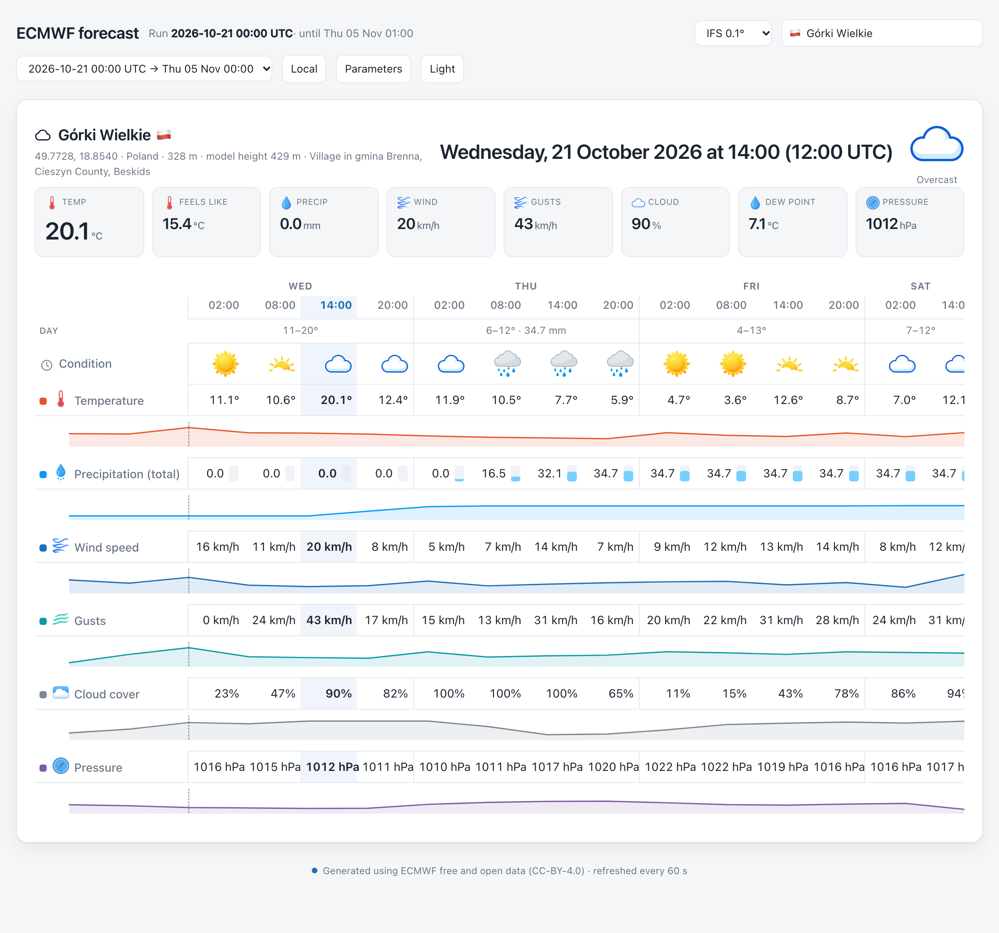

<div align="center">

# ECMWF forecast widget

**A point forecast service for ECMWF's free and open 0.1° data, and the
widget that shows it.**

[Open the live page](https://piokuc.github.io/ecmwf-widget/) ·
[Documentation](docs/index.md) ·
[ECMWF open data](https://www.ecmwf.int/en/forecasts/datasets/open-data)

</div>

---

<p align="center">
  
</p>

## What it does

Since the 20th of October 2026 ECMWF publishes its highest resolution
forecast at **0.1°, about 9 km**, as free and open data. There is no
account, no API key and no registration.

This project fetches that data, evaluates it at the places you care about
— cities, villages, summits — and serves it as a page you can use on a
phone.

- **Every parameter** ECMWF publishes is listed, and the ones you have
  downloaded can be switched on and off. The service fetches the thirteen
  interesting ones, all on the surface, and one line of configuration
  changes that.
- **Three models**: IFS at 0.1° and 0.25°, and the AIFS machine learning
  forecast.
- **Every capital**, a lot of major cities and some notable peaks, with
  flags, and any place you add yourself.
- **Fifteen days** of forecast, grouped by day, with the numbers and the
  plot of each parameter together.
- **The wind as arrows**, built from the two components, coloured by the
  Beaufort scale.
- **Local time and UTC**, a switch between the two, and the time the values
  belong to always in the corner.

The published page is built by a GitHub Action, every four hours after the
ECMWF cycles: it fetches the forecast, builds the page and deploys it. The
repository keeps nothing of it, so it does not fill up.

## Getting started

The package installs with pip, on macOS and on Linux alike. Python 3.10 or
newer is needed; nothing else.

```bash
pip install ecmwf-widget          # from PyPI
pip install .                     # from a checkout of the repository

ecmwf-service once                # fetch the latest run
ecmwf-widget --open               # and look at it
```

The widget is then on <http://localhost:8765>.

To keep it up to date, run the service as a daemon, and optionally the
publisher with it:

```bash
ecmwf-service run                 # keep the database up to date
```

The service finds the configuration of the machine by itself: the file
named by `ECMWF_WIDGET_CONFIG`, then `places.yml` in the working
directory, then the configuration of a checkout of the repository, and
lastly the starter configuration that comes with the package.

Run as a service (definitions in [`deploy/`](deploy)), the ingestor keeps
a stamped log of every run in `data/service.log`; the publisher keeps its
own in `data/publishd.log`.

The published page is updated by a GitHub Action, so it does not need the
laptop. To publish from the laptop instead, the publisher daemon follows
the ECMWF schedule itself — it waits for each cycle, pulls the data as
soon as it appears, rebuilds the page and pushes to GitHub, which is what
publishes the new version:

```bash
ecmwf-publisher                   # waits for each new run, then pushes
ecmwf-publisher --dry-run         # do everything except the push
```

Ready-made service definitions for macOS (`launchd`) and Linux
(`systemd`) are in [`deploy/`](deploy) — the ingestor as
`ecmwf-ingestd`, publishing as `ecmwf-publishd` — and GitHub Actions
builds
[distributable packages](docs/workflows.md#the-packages) for
both platforms: a wheel and a portable bundle per OS.

## The structure

The application lives in the `ecmwf_widget` package, under `src/`, so an
import from the repository root cannot pick up a stale copy. Everything
else has a place of its own:

```
src/ecmwf_widget/     the package
├── scheduler          the ECMWF publication schedule (0, 6, 12, 18 UTC)
├── service            the ingester: find runs, download, extract, store
├── auto_publish       the publishing daemon, on the schedule above
├── publish            one-shot fetch, build and push
├── build_site         the static page for GitHub Pages
├── widget             the local widget server, and the page itself
├── forecast           turning stored values into display structures
├── store              the SQLite store
├── points             places, GRIB grids and point extraction
├── ecmwf_open_data    the anonymous HTTPS client for the open data portal
├── models, parameters the catalogue of models and parameters
├── config             the configuration file, loading and validation
├── paths              where the files of the package and of the machine are
├── build_places       rebuilding the catalogue of world places
├── make_icons         generating the weather icons
├── download_9km       downloading a single file, without the database
├── assets             the weather icons and the app icons
└── data               the catalogue of world places, the starter configuration
tests/                 unit tests (pytest) and the website scenarios
├── unit/              the unit tests, one file per part of the service
└── features/          Cucumber descriptions of the published page,
                       executed with pytest-bdd against a served bundle
config/                the configurations of the repository
docs/                  the documentation of the project
deploy/                service files for launchd and systemd
scripts/               the build of the portable bundle
```

The names of the directories say what is in them: `src/` is the code,
`tests/` are the tests, `docs/` are the documents, `config/` are the
configurations, `deploy/` are the service definitions and `scripts/` are
the tools of the build. The state of the machine — the database, the GRIB
cache, the logs — is in `data/`, and the built page is in `site/`. Neither
is in the repository.

## The tests

```bash
python3 -m venv .venv
.venv/bin/python -m pip install -e ".[dev]"
PLAYWRIGHT_BROWSERS_PATH=.playwright .venv/bin/python -m playwright install chromium webkit
.venv/bin/python -m pytest    # unit tests, HTTP scenarios and real browser tests
pytest tests/unit            # just the unit tests
pytest tests/features        # HTTP scenarios
pytest tests/browser         # desktop/mobile Chromium and WebKit
```

Activate the virtual environment (`source .venv/bin/activate`) before using
the shorter `pytest` commands above.

The unit tests cover the schedule, the configuration, the parameters, the
store, the service (with the network faked away) and the publishing step
(against a throwaway git repository). The scenarios in
`tests/features/published_page.feature` describe what the published page
promises; they serve the built bundle over HTTP and check it the way a
visitor would receive it. When no page has been built, a small one is made
up for the scenarios, so they always run.

## The places

Your own places go in `places.yml`:

```yaml
places:
  - id: sniezka
    name: Śnieżka
    latitude: 50.73617
    longitude: 15.73972
    elevation: 1603
    country: Poland
    country_code: PL
    flag: 🇵🇱
```

And the catalogue of the world comes with the package, and you can follow
all of it, or part of it:

```yaml
catalogue: [region:europe, kind:peak]
```

## How it works

```
   ECMWF open data portal
          |  anonymous HTTPS
          v
   ecmwf-service ────► SQLite ────► ecmwf-widget ────► the page
```

The service finds the runs that are published, downloads only the fields it
needs using the index files and HTTP range requests, and evaluates them at
every place. The widget reads those values and draws them.

There is more in the [documentation](docs/index.md):

| | |
| --- | --- |
| [Overview](docs/overview.md) | How the pieces fit together |
| [Model architecture and review](docs/model-architecture.md) | The forecast model integration and prioritized improvements |
| [The data](docs/data.md) | What ECMWF publishes, the parameters, the units, the licence |
| [The data retriever](docs/retrieval.md) | How a run is found, fetched, decoded and stored |
| [The web page](docs/page.md) | How the page is built and how it renders |
| [Workflows](docs/workflows.md) | Every command and when to use it |
| [Publishing](docs/publishing.md) | GitHub Pages, the schedule daemon, the size limits |
| [The tests](docs/testing.md) | The unit tests and the Cucumber description of the page |
| [Development](docs/development.md) | The layout, the dependencies, the build and the release |

## The commands

| | |
| --- | --- |
| `ecmwf-service once` | Fetch the latest run and stop |
| `ecmwf-service run` | Keep the database up to date |
| `ecmwf-service status` | What has been fetched |
| `ecmwf-service export` | Everything, as a CSV |
| `ecmwf-widget --open` | The widget, in a browser |
| `ecmwf-widget --text` | The forecast as text |
| `ecmwf-publish` | Fetch, rebuild the page, commit and push |
| `ecmwf-publisher` | The same, on a schedule, on the laptop |
| `gh workflow run pages.yml` | Build and publish the page in GitHub |
| `ecmwf-make-icons` | Generate the weather icons |
| `ecmwf-build-places` | Rebuild the catalogue of world places |
| `ecmwf-build-site` | Build the static page on its own |
| `ecmwf-download` | Download a single file, without the database |

Every command is also `python -m ecmwf_widget <command>`, for the times
when the console scripts are not on the path.

## A note on the data

The 0.1° tier is published about two hours after the 0.25° one, and only
the 00 and 12 UTC runs carry the long range: the 06 and 18 UTC runs stop
at 144 hours. The widget shows the run that reaches furthest and says where
each run ends, so there is no guessing.

Every parameter is a full global field, so the twelve that are fetched cost
about 750 MB a run and asking for all forty-eight would cost six times
that. `parameters: all` in `places.yml` is the greedy option.

## Credits

Generated using [ECMWF free and open data](https://www.ecmwf.int/en/forecasts/datasets/open-data),
licensed under [CC-BY-4.0](https://creativecommons.org/licenses/by/4.0/).
ECMWF must be attributed.

The weather icons are generated with
[Z-Image-Turbo](https://huggingface.co/Tongyi-MAI/Z-Image-Turbo).
