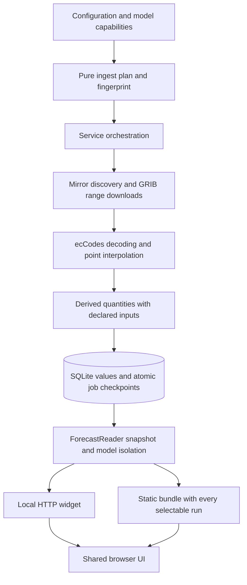

# Model architecture and review

This application downloads ECMWF forecast outputs; it does not train or run
IFS or AIFS. This document describes the implementation and review fixes made
on 22 October 2026.

## Architecture

### Product identity and capabilities

[`models.py`](../src/ecmwf_widget/models.py) defines immutable `Model` records
and a catalogue keyed by forecast product, including grid resolution.

| Product key | Upstream model | Grid | Stream/type |
| --- | --- | --- | --- |
| `ifs` | `ifs` | `0p1` | `oper/fc` |
| `ifs025` | `ifs` | `0p25` | `oper/fc` |
| `aifs` | `aifs-single` | `0p25` | `oper/fc` |

Models declare cycles, step cadence, short-cycle horizon and optional surface
and pressure parameter allowlists. IFS steps extend to 360 hours for 00/12 UTC
and 144 for 06/18; AIFS uses six-hour steps to 360 for all cycles. These
capabilities follow the [ECMWF product description](https://www.ecmwf.int/en/forecasts/datasets/open-data).
The capability catalogue must be reviewed when upstream products change.

Model resolution labels have an explicit mapping; unknown grid tokens retain
their name. Selection expands `all`, validates keys and removes duplicates
while preserving order. Configuration validates interpolation, coordinates,
pressure levels, retention and polling settings.

### Planning, extraction and recovery

[`ingest.py`](../src/ecmwf_widget/ingest.py) is the pure planning boundary.
A `Job` defines step, level type, required parameters and pressure levels. The
plan intersects configured steps with product support, omits unsupported
product fields and respects parameters limited to particular steps, such as
orography. Derived quantities declare their raw inputs and level type;
requesting pressure-level wind automatically requests `u` and `v`.

[`Service`](../src/ecmwf_widget/service.py) discovers indexes and downloads
through the configured mirrors. An unavailable primary no longer prevents
mirror discovery. Downloads retain their actual source and exhausted attempts
become recorded job failures. GRIB fields are decoded once per job and sampled
at all configured places using the grid geometry in the file.

For each job, the service compares extracted identities against the required
`(place, parameter, level)` set. A decoded missing value (`None`) is a recorded
observation, but an absent record is incomplete coverage. Empty extraction
never completes a job. Pressure derivations run for pressure-only batches and
skip incomplete component pairs without dropping other levels.

A fingerprint includes product capabilities, place definitions, parameters,
levels, steps, interpolation and a derivation version. Successful jobs resume
from SQLite checkpoints. A fingerprint change clears incompatible values,
place snapshots and checkpoints together; completed runs with an old
fingerprint are eligible for ingestion again. An empty plan stays partial
with an error, rather than becoming an empty complete run.

### Persistence and consistency

[`ForecastStore`](../src/ecmwf_widget/store.py) uses SQLite WAL with an
in-process reentrant lock. Schema version 4 adds ingest state and job records
without changing version 3 forecast data. Migration is transactional; unknown
older/newer versions are rejected instead of relabeled.

| Table | Primary key | Stored information |
| --- | --- | --- |
| `runs` | `(model, run)` | Cycle, resolution, ingest state and timestamps |
| `places` | `(model, run, place_id)` | Place metadata snapshot |
| `point_values` | `(model, run, place_id, param, level, step)` | Scientific value, unit and interpolation |
| `ingest_state` | `(model, run)` | Configuration/derivation fingerprint |
| `ingest_jobs` | `(model, run, step, levtype)` | Coverage status, source and failure detail |

Runs are `YYYYMMDDHH`; steps are lead hours. Surface levels use `-1` in
storage. Values and their job checkpoint commit in one transaction, so a
crash cannot leave a completed checkpoint without its values. Retention keeps
the configured newest runs plus the newest complete run if it would otherwise
be removed. This can retain one extra run per product.

A reader payload uses one SQLite read snapshot, even when a separate process
is ingesting. Job-level partial results are available explicitly. A
configuration change marks the affected run partial; the design does not keep
multiple configuration generations of that same run. Older complete runs
provide continuity where available.

### Reader contracts and scientific display

[`ForecastReader`](../src/ecmwf_widget/forecast.py) resolves an omitted model
to one product in catalogue order and carries that identity through value and
place queries. It never combines different products into one series. Each
place's values are loaded in one query, then grouped by parameter and level.

Default selection prefers complete runs with values, then maximizes the actual
end time (`cycle + last step`), with freshness breaking ties. If there are no
complete candidates it exposes a partial run. A place-specific request only
considers runs containing that place's values. Explicit run selection remains
available for comparison.

Display conversion respects stored units. Legacy records with missing cloud
or precipitation units use known product-specific encodings; numeric magnitude
is never used to guess fraction versus percentage. Precipitation increments
preserve unknown intervals after a missing total or reset, and carry start/end
lead hours. The browser marks incomplete daily rain summaries explicitly.
Elevation correction remains a reader-time transformation using the place and
orography from the selected product/run.

### Delivery and interaction

The local API and static builder share the reader and page implementation.
The static build embeds each offered run, rather than relabeling one payload
when the user changes runs. Place limits apply to both the payload and picker.
Embedded metadata escapes script delimiters.

Model/run changes reset selected hours; stale responses cannot overwrite a
newer selection. The place picker supports filtered Enter selection and Escape.
An empty parameter choice remains empty until the user restores defaults.
Tooltips are opt-in and persisted locally, with a checkbox.
Hovering still updates the hour and summary while tooltips are off.

## Review results

| Original issue | Implemented improvement | Regression evidence |
| --- | --- | --- |
| Completion counted jobs rather than coverage | Product plans, required point identities and resumable checkpoints | `test_ingest.py` |
| Different products could mix; run density beat horizon | Explicit model resolution and complete/valid-end selection | `test_forecast.py` |
| Pressure-only jobs skipped derived wind | Level-aware dependency expansion and pressure orchestration | `test_ingest.py` |
| Missing totals appeared dry and inflated later rain | Null/reset propagation and explicit intervals | Reader and browser tests |
| Primary outage blocked mirror use | Shared discovery/download source order and job failure records | `test_ingest.py` |
| Schema version was overwritten without migration checks | Transactional v3-to-v4 migration and future-version rejection | `test_store.py` |
| Reader queried every parameter separately | One value query per place, consistent payload snapshot | `test_forecast.py` |
| Static run selector did not change actual data | Embed all offered runs and exercise selection/reload | Browser tests |
| Legacy AIFS cloud cover displayed above 100% | Product-specific fallback for missing units | `test_forecast.py`, real-data visual review |

## Validation and remaining boundaries

See [testing](testing.md) for reproducible setup. Unit and HTTP scenarios run
alongside real Chromium and WebKit tests for desktop/mobile, live/static page
controls, errors, refresh and missing-data behavior. Tests use temporary stores
and do not download global forecast files. A separate smoke test used a backup
of the existing operational database: three products, 153 places per product,
six runs, both delivery paths and desktop/mobile screenshots. The original
operational database was not modified.

The architecture remains a single-machine service with SQLite. There is no
multi-writer ingest lease: run one ingestor per database. Checkpoints skip
completed jobs but retries re-download an incomplete job, not individual
missing fields. A field advertised by capabilities but absent upstream remains
partial for retry; capability changes require an explicit catalogue update.
Historical pre-version-3 databases need a separate migration. Payloads remain
plain dictionaries, with behavior and shape covered by tests; a fully typed
Python/JavaScript schema is a possible later improvement. The static bundle
grows with retained runs; measure its size before increasing retention.
